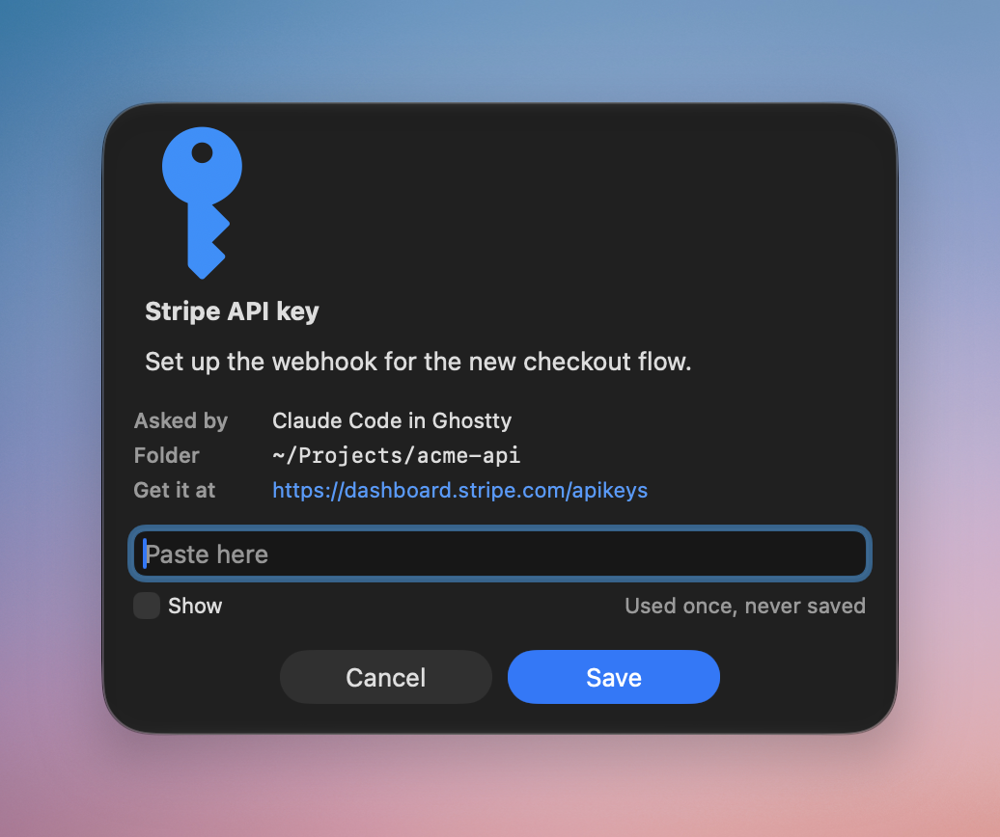

# ask-secret

<p align="center"></p>

When a coding agent needs an API key or your sudo password, the usual move is to paste it into the chat. That puts the secret in the transcript, in the logs, and on the model provider's servers.

ask-secret gives the agent a different way to ask. It opens a small macOS pop-up that says which agent is asking, from which folder, and why. You paste the value there. The agent gets it, and the chat never sees it.

Keys you want to reuse are saved in your login Keychain, so you're only asked once. Sudo passwords are never saved.

## Install

```sh
npx skills add theexperiencecompany/ask-secret -g
```

This works with Claude Code, Codex, Cursor and the other agents [skills.sh](https://skills.sh) supports. After that, your agent knows to use it whenever it needs a credential.

You need macOS and Apple's command line tools (`xcode-select --install`). The pop-up is a small Swift program, built on first use.

To run it yourself, put it on your PATH from wherever your agent installed the skill (for Claude Code that's `~/.claude/skills`):

```sh
~/.claude/skills/ask-secret/bin/ask-secret install
```

## Use

You don't need to remember any of this. Your agent runs it. But if you want to:

```sh
# Get a saved key, or ask for it the first time
ask-secret get stripe --what "Stripe API key" --why "Set up the webhook" --where "https://dashboard.stripe.com/apikeys"

# Run a command with sudo, here or on another machine over SSH
ask-secret sudo --why "Restart nginx" --on my-server -- systemctl restart nginx

# Ask for something once without saving it
ask-secret once --what "Wi-Fi password" --why "Join the office network"

# See, check and remove saved keys
ask-secret list
ask-secret has stripe
ask-secret forget stripe
```

In the pop-up, Enter saves, Esc cancels, and "Show" lets you check what you pasted. If you don't answer within 10 minutes it closes and the agent is told you cancelled.

## Where things are kept

Saved keys go in your login Keychain under `agent/<name>`. You can see, edit or delete them in Keychain Access. Nothing is sent anywhere else.

A secret the agent has read is in its working memory for that task. ask-secret keeps it out of the chat and off disk, but it doesn't stop an agent from misusing a value you hand it. Only give an agent keys you'd trust it with, and prefer short-lived or narrowly scoped ones.

## License

MIT
